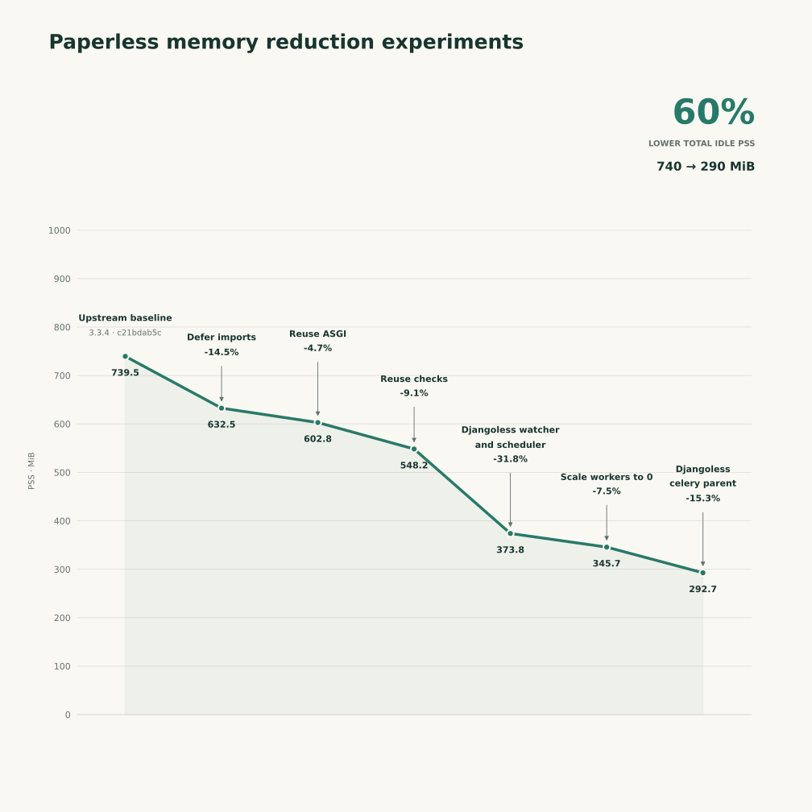

# Idle memory reduction analysis

I have run experiments. A reduction of at least 25% is achievable with minimal changes to the code, and no behavior changes at all.
Further large savings require running the folder watcher, celery scheduler and celery parent without django, and keeping django inside workers that can scale to 0. It's not a revolution in the code base by any means, but I'll keep those to a fork since there is no interest.

The changes I will propose upstream:

1. **Make shared modules safe to import**: Importing task definitions, views or parser registrations should not also load the processing engines behind them. For example, documents.views imported AI classification and chat implementations at module scope, while `documents.tasks` imports AI indexing implementations, even when AI is disabled. The change keeps registration and shared interfaces lightweight, importing implementations only when an operation actually needs to run. The same applies to OCR, PDF processing, classifiers and parser dependencies.
1. **Reuse the initialized ASGI application**: asgi.py already creates a Django ASGI application before importing routing, but then calls get_asgi_application() again for HTTP routing. Reusing the existing instance avoids retaining a second middleware stack.
1. **Run Docker startup checks once**: The Docker initialization already runs Django system checks before starting the services. The consumer, scheduler and worker then repeat them. Their Docker launchers can skip those repeated checks while retaining the initial validation gate. **This does not affect bare-metal/systemd deployments**: the change is confined to Docker S6 launch scripts; standalone management commands and Celery invocations keep their normal checks.

For the curious among us:

4. **Djangoless watcher and scheduler**: Replaced by a small filesystem watcher and Supercronic. Both require an API token. The watcher submits a relative file path and metadata from the consumption directory; **it does not upload the document over HTTP**. The lightweight scheduler only keeps time: when a job is due, it calls the API, and the already-running Django web process queues the configured Celery task for the existing worker to execute. This is exactly what the current scheduler does, except that it doesn't call the API and it takes 150 MiB and a full django setup :/
5. **Djangoless Celery parent and scale workers down to 0**: it moves Django initialization out of the remaining parent and into task children and temporary helpers. This has larger compatibility implications, since we must then avoid using django models in the celery parent.

| Component                            | Upstream idle | Final idle |
|--------------------------------------|--------------:|-----------:|
| Web application and server processes |     242.1 MiB |  203.8 MiB |
| Folder watcher                       |     147.9 MiB |   21.0 MiB |
| Scheduler                            |     161.0 MiB |   10.1 MiB |
| Celery parent                        |      98.3 MiB |   57.8 MiB |
| Celery children                      |      90.2 MiB |    0.0 MiB |
| **Total**                            | **739.5 MiB**| **292.7 MiB** |
